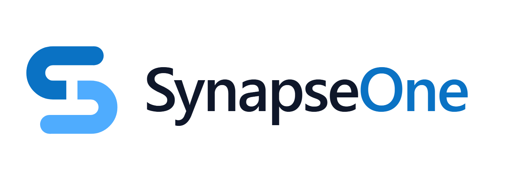

<p align="center">
  <picture>
    <source media="(prefers-color-scheme: dark)" srcset="apps/console/public/brand/logo-lockup-dark.png">
    
  </picture>
</p>

# SynapseOne — the open PaaS for your infrastructure

[](https://github.com/vku-open-source-2026/SynapseOne/actions/workflows/ci.yml)
[](https://github.com/vku-open-source-2026/SynapseOne/releases)
[](LICENSE)
[](https://www.npmjs.com/package/@synapseone/sdk)
[](https://www.npmjs.com/package/@synapseone/cli)
[](https://pypi.org/project/synapseone-sdk/)

**SynapseOne is an open-source Tier-1 PaaS (Apache-2.0): one API gateway, AWS-style access
management, a core data cluster (documents, cache and queue), and native workflows —
operated through a web Console, SDKs in four languages, and a zero-dependency CLI.**

No lock-in: Authentik/Keycloak runs as an optional external IdP over
standard OIDC. Everything else is SynapseOne code, pure Apache-2.0.

- 🌐 **Live demo:** [synapseone.space](https://synapseone.space) · Console: [cloud.synapseone.space](https://cloud.synapseone.space) · API: `https://api.synapseone.space/health`
- 📦 **Install:** `npm i @synapseone/sdk` · `pip install synapseone-sdk` · `npx @synapseone/cli` · Go and Rust SDKs via the monorepo (see below)
- 🚀 **Self-host:** public GHCR images (`docker compose pull`) or build from source (`docker compose up -d --build`) — see [Self-host](#self-host)

## Why SynapseOne

| Capability | What you get |
|---|---|
| **API Gateway** | Single entry point: JWT/API-key auth, principal propagation (`x-synapseone-*`), edge rate limiting, tracing, aggregate `/ready`, Prometheus `/metrics` |
| **AWS-style IAM** | Organization → Account → User → Role → JSON Policy (Allow/Deny + Condition), enforced per-route scopes, `authorize` API + dry-run simulator, mutation audit trail, tenant isolation on every write (role-based, same-org fallback) |
| **Flexible identity** | First-party password lifecycle (register/login/change/reset/verify), TOTP MFA with recovery codes, sign-in lockout, short-lived JWT, atomic rotating refresh tokens, API keys, service accounts, delegated user-token exchange for Tier 2, and real OIDC Authorization Code flow (Authentik/Keycloak) with shadow users |
| **Core data** | Postgres (source of truth) + Valkey (Redis-protocol) + SeaweedFS (S3-compatible, Apache-2.0) object storage, versioned schema, idempotent seed, daily Postgres dumps and incremental object snapshots with restore |
| **SynapseBase** | Self-managed document database: collections, object↔data mapping with validation, filters/cursors, optimistic concurrency, atomic counters, batches and a change feed (`/v1/base`) |
| **Synapse Faststore** | Valkey-backed cache/KV and data structures: TTL strings, counters, hashes, lists, sets, sorted sets, scans, batches and distributed locks (`/v1/faststore`) |
| **SynapseQueue** | At-least-once messaging: delayed/deduplicated publishing, visibility-timeout leases, ack/nack/heartbeat, retries, dead letters and replay (`/v1/queue`) |
| **SynapseStream** | Tenant-scoped event log over Valkey/Redis Streams or Kafka with consumer groups, acks and retention (`/v1/stream`) |
| **Synapse Warehouse** | Tenant-scoped OLAP: DuckDB datasets, read-only SQL, batch SQL transforms and SynapseStream-driven stream ETL, plus workflow templates (`/v1/warehouse`) |
| **SynapseOCS** | Tenant-scoped buckets/objects with direct + multipart upload, presigned URLs, checksums, size/type limits and quotas (`/v1/ocs`, legacy `/v1/storage`) |
| **SynapseNotifications** | Durable outbox + `{{var}}` templates, per-recipient preferences/unsubscribe, email/SMS/push relays, webhooks, retries and dead letters (`/v1/notifications`) |
| **Workflows** | Built-in workflow engine (Apache-2.0): queue-backed DAG runner, versioned templates, activate/deactivate/execute (real webhook & cron triggers), sandboxed code execution, execution history, visual graph editor, and self-hosted runner image for hybrid/private execution |
| **Linked Data (SynapseLDS)** | Licence-picked NGSI-LD datasources: structural-allowlist projection (`_core` never serialized), per-attribute visibility (public/restricted/internal), default-deny schema registry, workflow publish node (`lds.publish-record`) |
| **AI assistant** | Chatbot on the API Docs page: decision model picks the endpoint, LLM pre-fills the try-it form (server-side key, guidance-only, never public) |
| **Clients** | TypeScript, Python, Go and Rust SDKs with full API parity, zero-dependency CLI, admin Console |

## Try it in 30 seconds

No install needed — point the clients at the live demo:

```bash
# CLI, straight from the registry (Node 18+)
npx -y @synapseone/cli@latest --base https://api.synapseone.space login --email demo@acme.local
npx -y @synapseone/cli@latest --base https://api.synapseone.space orgs
```

```python
# Python SDK
pip install synapseone-sdk
```

```python
from synapseone_sdk import SynapseOneClient
c = SynapseOneClient("https://api.synapseone.space")
login = c.iam.login("demo@acme.local")
c.set_api_key("<your-key>")  # create one in the Console: cloud.synapseone.space → Keys
print(c.iam.list_orgs())
```

Or open the [Console](https://cloud.synapseone.space) and sign in with an API key.

## Install

```bash
# JavaScript / TypeScript
npm install @synapseone/sdk

# Python (3.9+)
pip install synapseone-sdk

# Go (1.22+) — the SDK lives in this monorepo (sdks/sdk-go); wire it with a
# replace directive (a standalone module repo is planned — the monorepo path
# contains uppercase letters, which Go module paths forbid):
#   go mod edit -replace github.com/synapseone/synapseone-sdk-go=<checkout>/sdks/sdk-go

# CLI — one-line installer (Node 18+, no clone needed)
curl -fsSL https://synapseone.space/install.sh | sh
# ..or run without installing anything:
npx -y @synapseone/cli@latest --help
```

```ts
// TypeScript
import { SynapseOneClient } from '@synapseone/sdk';
const c = new SynapseOneClient({ baseUrl: 'https://api.synapseone.space' });
const { accessToken } = await c.iam.login('demo@acme.local');
c.setToken(accessToken);
await c.workflow.createWorkflowFromTemplate('webhook-to-log', 'demo');

await c.faststore.set('cache:demo', { ok: true }, { ttlSeconds: 300 });
await c.queue.publish('emails', { to: 'demo@acme.local' });
```

The TypeScript, Python and Go clients cover the full API (`docs/api.md`): password lifecycle + OIDC,
refresh/logout, delegated token exchange, orgs/accounts/users, roles/policies,
authorize + dry-run, audit, API keys, service accounts, workflows/templates/
executions, LDS, Base, Faststore, Queue, Stream, Object Storage, Notifications,
AI and inference (streaming). A Rust SDK (`sdks/sdk-rust`, crate `synapseone`,
version `0.9.0`) covers the same service namespaces and is ready for crates.io
publication.
The SDKs are split per service namespace
(`c.iam`, `c.workflow`, `c.lds`, `c.base`, `c.faststore`, `c.queue`,
`c.stream`, `c.storage`, `c.notifications`, `c.ai`, `c.inference`, `c.health`);
legacy flat methods still work with a deprecation warning. See the parity
matrix in `docs/sdk-js.md` for the few intentional differences.

## Self-host

Two supported paths produce the same stack. Every first-party image is published
to the public GitHub Container Registry as
`ghcr.io/vku-open-source-2026/synapseone-<service>:<tag>` (Apache-2.0, no
registry login needed). Pin a release tag for reproducible deployments, or use
`latest`.

### 1. Run the published images (recommended)

Requirements: Docker Engine 24+, Docker Compose v2.24+, ~4 GB RAM.

```bash
git clone https://github.com/vku-open-source-2026/SynapseOne.git
cd SynapseOne
cp .env.example .env      # replace every *_change_me_* secret
export SYNAPSEONE_VERSION=v0.9.0   # or latest
docker compose pull
docker compose up -d --no-build
curl localhost:8080/health && curl localhost:8080/ready
open http://localhost:3000   # sign in: demo@acme.local / org acme
```

The release publishes these public images (same names as the Compose services):

| Images | Purpose |
|---|---|
| `synapseone-gateway`, `synapseone-console` | public API edge and admin UI |
| `synapseone-iam`, `synapseone-workflow`, `synapseone-ai` | identity, workflows, docs assistant |
| `synapseone-lds`, `synapseone-base`, `synapseone-faststore` | linked data, documents, cache |
| `synapseone-queue`, `synapseone-stream`, `synapseone-notifications` | messaging, event log, outbox |
| `synapseone-ocs`, `synapseone-inference` | object storage, LLM/embeddings/decision |
| `synapseone-postgres`, `synapseone-edge` | Postgres 16 + pgvector/PostGIS, TLS edge |

> If `docker pull` returns `unauthorized`, the GHCR packages have not been
> switched to public yet. An organization admin must add a `GHCR_PAT` secret
> (package admin) and run the `packages-public` workflow once; releases also try
> to flip visibility automatically when that secret exists.

### 2. Build from source

```bash
git clone https://github.com/vku-open-source-2026/SynapseOne.git
cd SynapseOne
cp .env.example .env      # replace every *_change_me_* secret

# Node 20+ monorepo build (services, SDKs, CLI, Console)
npm ci
npm run build

# Build every image locally and start the stack
docker compose build
docker compose up -d --no-build
```

`docker compose up -d --build` combines the last two steps. The previous
`synapseone/*` image names are replaced by the GHCR names above; a local build
tags them with the same names so `up` never needs a registry round-trip.

Production (TLS, edge rate limiting, hardened secrets): `docker-compose.prod.yml` +
`infra/prod/` (nginx + Let's Encrypt via Certbot). Full checklist: `docs/production.md`.

| Layer | Endpoint (local) | Notes |
|---|---|---|
| Console | `http://localhost:3000` | Admin UI (React + Vite) |
| Gateway | `http://localhost:8080` | The only public API in production |
| IAM | `http://localhost:4001` | Internal (behind gateway in prod) |
| Workflow | `http://localhost:4002` | Internal (behind gateway in prod) |
| LDS | `http://localhost:4004` | Internal — SynapseLDS NGSI-LD datasources (behind gateway in prod) |
| Base | `http://localhost:4005` | Internal — SynapseBase documents + mapping (behind gateway in prod) |
| Faststore | `http://localhost:4006` | Internal — cache/KV/data structures (behind gateway in prod) |
| Queue | `http://localhost:4007` | Internal — SynapseQueue messaging (behind gateway in prod) |
| Stream | `http://localhost:4009` | Internal — SynapseStream event log (behind gateway in prod) |
| Warehouse | `http://localhost:4012` | Internal — Synapse Warehouse OLAP + ETL (behind gateway in prod) |
| OCS | `http://localhost:4010` | Internal — buckets, objects and presigned URLs |
| Notifications | `http://localhost:4011` | Internal — durable notification outbox |
| Inference | `http://localhost:4008` | Internal — LLM proxy, embeddings, decision |

## Architecture

```
Client → Gateway :8080 ─┬─► IAM :4001           (Org/Account/Role/Policy + tokens + OIDC)
                         ├─► Workflow :4002      (built-in Apache-2.0 engine)
                         ├─► AI :4003 / Inference :4008
                         ├─► LDS :4004           (licensed NGSI-LD exports)
                         ├─► Base :4005          (documents + object↔data mapping)
                         ├─► Faststore :4006     (cache/KV/data structures)
                         ├─► Queue :4007         (at-least-once messaging)
                         ├─► Stream :4009        (event log / consumer groups)
                         ├─► Storage :4010       (objects, multipart, presign)
                         └─► Notifications :4011 (outbox + delivery)
                         Postgres :5432 / Valkey :6379 / SeaweedFS (S3) :9090
                         pg-backup + s3-backup → volumes pgbackups / s3backups
```

Authentik (or Keycloak) acts purely as a federated IdP over OIDC; IAM keeps the shadow
user and all authorization. Details: `docs/architecture.md`, `docs/iam-model.md`.

## Repository layout

```
apps/console               Admin UI (React + Vite + Tailwind)
apps/gateway               API gateway (Rust/Axum; proxy, JWT/API-key, principal headers, /metrics)
apps/iam-service           IAM + tokens + authorize/simulator + real OIDC code flow
apps/workflow-service      Workflow engine (local built-in DAG runner, sandboxed code, triggers)
apps/lds-service           SynapseLDS — NGSI-LD datasources, registry, licensed exports (Rust)
apps/base-service          SynapseBase — documents, mapping, queries, change feed (Rust)
apps/faststore-service     Synapse Faststore — cache/KV, data structures, locks (Rust)
apps/queue-service         SynapseQueue — publish/consume, leases, retries, DLQ (Rust)
apps/stream-service        SynapseStream — topics, consumer groups, acks (Rust)
apps/warehouse-service     Synapse Warehouse — OLAP datasets, SQL, batch/stream ETL (Rust)
apps/ocs-service           SynapseOCS — objects, multipart, presign, quotas (Rust)
apps/notifications-service SynapseNotifications — outbox, templates, preferences (Rust)
apps/ai-service            SynapseOne AI assistant — LLM routing + call generation (Rust)
sdks/sdk-js                @synapseone/sdk (TypeScript, zero runtime deps)
sdks/sdk-python            synapseone-sdk (Python, requests only)
sdks/sdk-go                synapseone-sdk-go (Go, stdlib only)
sdks/sdk-rust              synapseone (Rust, async reqwest/tokio)
tools/cli                  synapseone CLI (zero deps, Node 18+) + install.sh
tools/backup               pg-backup.sh / pg-restore.sh / s3-backup.mjs (backup + restore)
infra/prod                 Production edge: nginx + Certbot overlay
infra/monitoring           Prometheus (scrape gateway/PG/Valkey + alert rules)
infra/k8s/base             Kustomize manifests for Kubernetes
infra/postgres/init.sql    Database bootstrap (extensions + journal schema; services own migrations)
examples/quickstart        End-to-end demo script
tests/e2e                  Smoke tests + live SDK checks
docs                       Start at docs/README.md
```

## Documentation

| Guide | Content |
|---|---|
| `docs/quickstart.md` | Run in 3 commands, your first flow |
| `docs/api.md` | Complete API reference |
| `docs/synapsebase.md` | SynapseBase — documents, object↔data mapping, queries, changes |
| `docs/faststore.md` | Synapse Faststore — cache/KV, data structures, locks |
| `docs/queue.md` | SynapseQueue — publish, consume, leases, retries, dead letters |
| `docs/iam-model.md` | Authorization model with examples |
| `docs/configuration.md` | Every environment variable |
| `docs/production.md` | Production checklist (secrets, TLS, edge, backups) |
| `docs/console.md` | Operating the Console |
| `docs/object-storage.md` | SynapseOCS bucket/object API, SeaweedFS backend, object backups |
| `docs/notifications.md` | SynapseNotifications — templates, preferences, delivery, retries |
| `docs/troubleshooting.md` | Common failures and fixes |

## Common commands

| Command | Description |
|---|---|
| `make bootstrap` | Copy `.env` + install all workspaces |
| `make build` / `make test` | Build / test the entire monorepo |
| `make compose-up` / `make compose-down` | Start / stop the platform |
| `bash tests/e2e/api-check.sh` | Full API e2e (requires `jq`) |
| `make sdk-check` | Live SDK check, JS + Python (needs a running gateway) |

## Contributing · Security · License

- Contributing: [`CONTRIBUTING.md`](CONTRIBUTING.md) · Code of conduct: [`CODE_OF_CONDUCT.md`](CODE_OF_CONDUCT.md) · Governance: [`GOVERNANCE.md`](GOVERNANCE.md) · Roadmap: [`ROADMAP.md`](ROADMAP.md) · Changelog: [`CHANGELOG.md`](CHANGELOG.md)
- Security: please **do not** open public issues for vulnerabilities — see [`SECURITY.md`](SECURITY.md).
- License: Apache-2.0 ([`LICENSE`](LICENSE)), third-party notices: [`NOTICE`](NOTICE), [`THIRD-PARTY.md`](THIRD-PARTY.md).

## PoF project checklist

- License: Apache-2.0 (`LICENSE`) with per-source SPDX headers and attribution in `NOTICE`.
- Build from source: `npm ci && npm run build` using the documented Node.js/Python toolchains.
- Issue tracker: [GitHub Issues](https://github.com/vku-open-source-2026/SynapseOne/issues).
- Change history: [`CHANGELOG.md`](CHANGELOG.md). Versioned release tags are published on GitHub.
- Dependency inventory: [`THIRD-PARTY.md`](THIRD-PARTY.md); dependencies are not modified or bundled into the repository.

## Brand

Logo, icon and social-preview assets live in [`apps/console/public/brand`](apps/console/public/brand). The console serves the favicon, web app manifest and icons from `apps/console/public`.

To set the GitHub repository social preview, upload [`apps/console/public/brand/social-preview.png`](apps/console/public/brand/social-preview.png) in **Settings → Social preview**.
