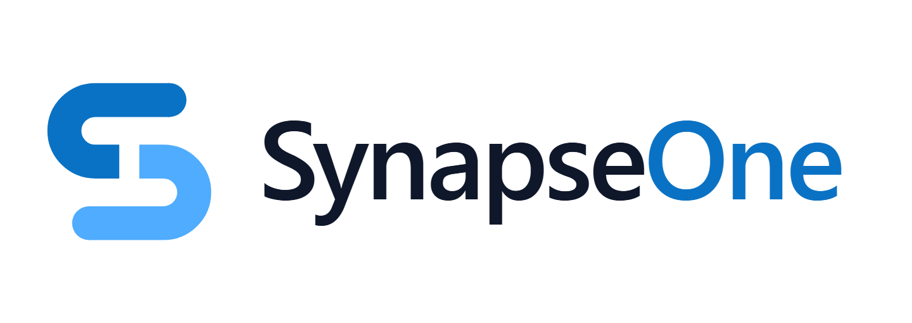
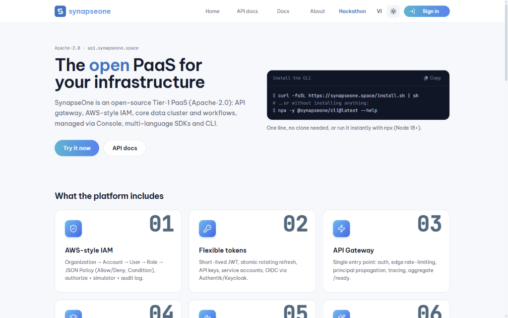
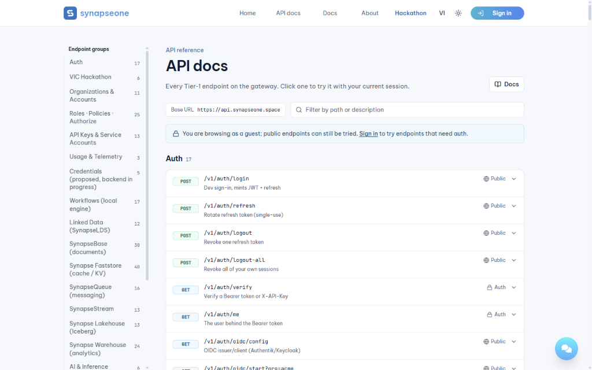

<p align="center">
  <picture>
    <source media="(prefers-color-scheme: dark)" srcset="apps/console/public/brand/logo-lockup-dark.png">
    
  </picture>
</p>

<h3 align="center">The open-source Tier-1 PaaS for modern digital infrastructure</h3>

<p align="center">
  <a href="https://github.com/vku-open-source-2026/SynapseOne/actions/workflows/ci.yml"></a>
  <a href="https://github.com/vku-open-source-2026/SynapseOne/releases"></a>
  <a href="LICENSE"></a>
  <a href="https://www.npmjs.com/package/@synapseone/sdk"></a>
  <a href="https://www.npmjs.com/package/@synapseone/cli"></a>
  <a href="https://pypi.org/project/synapseone-sdk/"></a>
</p>

<p align="center">
  <a href="https://synapseone.space">Live Portal</a> ·
  <a href="https://cloud.synapseone.space">Admin Console</a> ·
  <a href="https://cloud.synapseone.space/api-docs">Interactive API Docs</a> ·
  <a href="docs/README.md">Documentation</a>
</p>

---

**SynapseOne** is a self-hostable Tier-1 Platform-as-a-Service (`Apache-2.0`) bundling an API gateway, AWS-style IAM, managed data primitives, linked-data publishing, AI inference, and a DAG workflow engine behind one unified contract. Operate it from the web Console, a zero-dependency CLI, or typed SDKs in TypeScript, Python, Go, and Rust.

## Preview

| Platform Landing (`synapseone.space`) | Interactive API Reference (`cloud.synapseone.space/api-docs`) |
| :---: | :---: |
|  |  |

## Key Capabilities

| Layer | Service | Description |
| :--- | :--- | :--- |
| **Edge & Auth** | **Gateway & IAM** | Single entry point (`:8080`), JWT/API-key auth, Organization → Account → Role → JSON Policy (`Allow`/`Deny` + Conditions), TOTP MFA, OIDC federation (Authentik/Keycloak), and audit trail. |
| **Documents & KV** | **SynapseBase & Faststore** | Validated document collections with cursors, optimistic concurrency, and change feeds (`/v1/base`); Valkey-backed TTL KV, data structures, and distributed locks (`/v1/faststore`). |
| **Messaging & Events** | **SynapseQueue & Stream** | At-least-once queues with leases, retries, and DLQ (`/v1/queue`); tenant-scoped event streams with consumer groups (`/v1/stream`). |
| **Analytics & Storage** | **Warehouse, Lakehouse & OCS** | DuckDB OLAP SQL & stream ETL (`/v1/warehouse`); Apache Iceberg v2 Parquet tables (`/v1/lakehouse`); S3-compatible SeaweedFS buckets & presigned URLs (`/v1/ocs`). |
| **Open Data & Ops** | **SynapseLDS, Workflows & AI** | Licensed NGSI-LD projections (`/v1/lds`), DAG workflow runner with cron/webhook triggers (`/v1/workflows`), durable notification outbox (`/v1/notifications`), and LLM/embedding routes (`/v1/inference`). |

## Architecture

```text
Client / SDK / CLI
   │
   ▼
Gateway (:8080) ──┬──► IAM (:4001)            Org/Account/Role/Policy, JWT, API keys, OIDC
                  ├──► Workflow (:4002)       Built-in DAG runner, cron/webhook triggers
                  ├──► AI (:4003) / Inference (:4008)
                  ├──► SynapseLDS (:4004)     Licensed NGSI-LD datasources & exports
                  ├──► SynapseBase (:4005)    Document store, schema mapping, change feed
                  ├──► Faststore (:4006)      Valkey cache, KV structures, locks
                  ├──► SynapseQueue (:4007)   Leased messaging, retries, dead-letter queue
                  ├──► SynapseStream (:4009)  Event log & consumer groups
                  ├──► SynapseOCS (:4010)     Buckets, multipart uploads, presigned URLs
                  ├──► Notifications (:4011)  Templates, preferences, durable outbox
                  └──► Warehouse (:4012)      DuckDB OLAP SQL & stream ETL
                       │
                       ▼
        Postgres 16 (PostGIS/pgvector) · Valkey 8 · SeaweedFS (S3)
```

## Quickstart

### 1. Try the Live Demo (Zero Install)

Create a free account at [`cloud.synapseone.space/register`](https://cloud.synapseone.space/register) (requires **Node.js 18+** for the CLI):

```bash
npx -y @synapseone/cli@latest --base https://api.synapseone.space \
  login --email you@example.com --org your-org --password '<your-password>'
npx -y @synapseone/cli@latest --base https://api.synapseone.space orgs
```

### 2. Self-Host with Docker Compose (Recommended)

Requires **Docker Engine 24+**, **Docker Compose v2.24+**, and ~4 GB RAM. Prebuilt `Apache-2.0` images are published to GHCR:

```bash
git clone https://github.com/vku-open-source-2026/SynapseOne.git
cd SynapseOne
cp .env.example .env                 # replace *_change_me_* secrets before production use
export SYNAPSEONE_VERSION=v0.10.0    # or latest

docker compose pull
docker compose up -d --no-build
curl http://localhost:8080/health && curl http://localhost:8080/ready
```

Open `http://localhost:3000` to access the Admin Console (`demo@acme.local`, org `acme`).

### 3. Build from Source

Requires **Node.js 20+** and **Docker Compose v2.24+**:

```bash
cp .env.example .env
npm ci
npm run build
docker compose up -d --build
```

## Usage

### Install Clients

```bash
# TypeScript / JavaScript
npm install @synapseone/sdk

# Python (3.9+)
pip install synapseone-sdk

# Go (1.22+) & Rust
go get github.com/vku-open-source-2026/SynapseOne/sdks/sdk-go@latest
cargo add synapseone

# Zero-dependency CLI
curl -fsSL https://synapseone.space/install.sh | sh
```

### TypeScript SDK

```ts
import { SynapseOneClient } from '@synapseone/sdk';

const client = new SynapseOneClient({ baseUrl: 'https://api.synapseone.space' });
const { accessToken } = await client.iam.login('demo@acme.local');
client.setToken(accessToken);

await client.faststore.set('cache:demo', { ready: true }, { ttlSeconds: 300 });
await client.queue.publish('jobs', { task: 'sync-metrics' });
await client.workflow.createWorkflowFromTemplate('webhook-to-log', 'demo-flow');
```

### Python SDK

```python
from synapseone_sdk import SynapseOneClient

client = SynapseOneClient("https://api.synapseone.space")
client.set_api_key("<your-api-key>")  # create a key in Console -> Keys

print(client.iam.list_orgs())
client.faststore.set("status:node-1", {"healthy": True}, ttl_seconds=120)
```

## Repository Layout

```text
apps/        gateway, console, iam, workflow, lds, base, faststore, queue, stream, warehouse, ocs, notifications, inference
sdks/        sdk-js (@synapseone/sdk), sdk-python (synapseone-sdk), sdk-go, sdk-rust
tools/       cli (@synapseone/cli) and Postgres/S3 backup scripts
infra/       production nginx + Certbot overlay, Prometheus rules, Kustomize k8s manifests
docs/        architecture, API reference, IAM guide, service guides, production checklist
tests/e2e/   API smoke tests and live multi-SDK verification suites
```

## Documentation

- [Quickstart Guide](docs/quickstart.md) — first end-to-end flow in 3 commands
- [API Reference](docs/api.md) — complete gateway route & payload contract
- [IAM & Policy Model](docs/iam-model.md) — organizations, roles, policies, OIDC
- [Production Checklist](docs/production.md) — TLS, secrets, backups, monitoring (`docker-compose.prod.yml`)
- [Troubleshooting](docs/troubleshooting.md) — common operational issues and fixes

## Development & Contributing

```bash
make bootstrap          # copy .env and install workspace dependencies
make build              # build all services, SDKs, CLI, and Console
make test               # run unit and integration test suites
bash tests/e2e/api-check.sh   # run full end-to-end API checks (requires jq)
```

Contributions are welcome! Please review [CONTRIBUTING.md](CONTRIBUTING.md), [CODE_OF_CONDUCT.md](CODE_OF_CONDUCT.md), and [GOVERNANCE.md](GOVERNANCE.md). Report security vulnerabilities privately per [SECURITY.md](SECURITY.md). Release history is tracked in [CHANGELOG.md](CHANGELOG.md).

## License

Licensed under the [Apache License 2.0](LICENSE). See [NOTICE](NOTICE) and [THIRD-PARTY.md](THIRD-PARTY.md) for attribution details.
